# Interactive singing lessons, score reflow and guide octave

Historical PR #14 verification. The current two-mode flow and shared guide defaults are described in [Unified practice modes](unified-practice-modes.md).

Prepared from main including PR #13. The octave behaviour follows the subsequent user clarification: move the **singing target and audible vocal guide**, while leaving the written score and all accompaniment unchanged.

## Responsive notation

The microphone-mode grid changed the notation column without consistently notifying OSMD. Window resize alone did not catch column changes caused by the tuner or review companion; intrinsic minimum widths could also keep the music column wide. OSMD already had its independent auto-resize disabled so that app-owned geometry could be rebuilt together.

The app now observes the actual score container width, coalesces meaningful changes, and explicitly schedules layout after mode changes. The grid children can shrink to their available column. OSMD renders the music again at that width; SVGs are not CSS-scaled. Rendering rebuilds cursor timestamps, target geometry, current/previous traces, bar dimming and coaching highlights. A stopped seek position survives reflow; active transport and review retain their respective clocks. A drag defers reflow until release. Pitch samples do not schedule notation rendering. Phones place the compact tuner above the music.

Browser evidence using the included Chorus (Two part) score:

| Layout | Actual score width | Actual notation result |
| --- | ---: | --- |
| Desktop Listen, Full score | 1356 px | First system holds bars 1–6 |
| Desktop Assisted, Full score | 1236 px | First system holds bars 1–5; remaining bars move down |
| Tablet portrait Assessment, Full score | 604 px | Five musical systems |
| Phone portrait, Vocal focus | 326 px | Eight systems, one bar per system |
| Tablet portrait completed review | 724 px | Rebuilt notation and 124 real trace points |
| Tablet landscape review playback | 622 px | Rebuilt notation and the same 124 trace points |

These were OSMD measure-region/system positions and SVG dimensions, not outer-card width alone. The two-pixel SVG/container difference is OSMD's rendering edge, not a retained wide system.

## Connected, explicit demonstrations

The visual navigation tour still follows the real control rows. It leads into eight replayable lessons in four sections: starting pitch/octaves, pitch accuracy/score trace, Mixer/tempo, and section repetition/review. Watch demo is always a student action. Try it closes and restores the example before opening the real activity. Next, Back, Skip and Escape stop audio and clean up temporary state.

`src/tutorial-demo.js` provides deterministic frames and an output-only vowel oscillator. Audio and display use the same Web Audio clock and cents curve: −35 cents for 2.4 seconds, a smooth two-second correction, then +2 cents held long enough to see. Existing tuning colours are reused. At B♭3 the browser showed 228.4 Hz flat and 233.4 Hz corrected. The latter is green.

`src/tutorial-demo-ui.js` adapts the actual tuner, octave cards, score cursor/geometry, Mixer sliders and tempo control. Four or five selected-score notes drive a dedicated temporary SVG trace. The tempo example repeats the same two notes at 100% then 70%. Practice repeats a short section twice with real outside-bar dimming. The review example is explicitly simulated feedback with bar playback, not a saved student take.

The actual octave interface has a temporary demo mode with local candidate selection and no microphone request. Real candidate selection remains explicit. Meter text, cursor, octave choice, guide state, part enabled states/volumes/sounds, tempo, panels, Repeat and review visibility are restored. Demo traces use private arrays and their own SVG layer. Live microphone handlers and preference saves return early during a demo; real takes cannot start alongside it. Loading a score, leaving the tutorial or cancelling asynchronous sample preparation cannot restart old audio. Updates wait until demos have finished.

### Actual Mixer output

The Mixer lesson uses the existing part engines, real controls and actual master gains. Piano moves through 95%, 30%, muted, then 40%; the guide has separate 40%/80% levels and a real sound change. Browser inspection measured master gain **0.4478866 at 95%** and **0.0944833 at 30%**, about 13.5 dB lower. An analyser attached to that output measured a nonzero waveform (for example RMS 0.01159 during the loud phrase). The small live level meter is that measured signal, not a scripted animation. RMS frames from different phases are not used as a loudness comparison. Acoustic speaker output was not measured.

## Assessment guide and octave

Assessment defaults to an enabled guide at 70%. Assisted retains 92%. Each mode persists its own enabled state and level; old global levels migrate only into Listen/Assisted so they cannot override the new Assessment default. Mixer exposes on/off, level, Human voice and Synthetic Ah. Disabling the guide omits its playback route. Guide adjustments do not change accompaniment levels.

Settings exposes **Singing & guide octave** directly, above Advanced: two octaves lower, octave lower, written pitch and octave higher. This is the same confirmed choice as the large octave cards. The notation and MusicXML remain unchanged. Playback applies the explicit octave only to the selected guide route, including when an instrumental part is selected as the practice line; all other vocal and piano routes remain unchanged. Preview pitches are already absolute, so they are not shifted twice. After an octave change, a prompt encourages hearing the first note and singing it back. A labelled **Hear first note** button beside the Settings octave choices closes Settings and runs the existing starting-note preview, with normal microphone/confirmation rules. It never starts a take or auto-plays sound on selection. The choice stays locked during a take.

Immutable take metadata includes the actual guide enabled state, voice, volume and `guideOctaveShift`. Pause/resume retains the locked octave; review schedules from the captured guide octave. Older takes without that field retain written guide playback. The guide stays on the output graph; microphone capture, pitch tracking and scoring are unchanged. Headphones are recommended because real speakers can acoustically leak into a microphone.

## Verification

- `npm run generate`, `npm run check` under Node 20, `npm run build`, `npm run offline:check`, and `git diff --check` pass. **228 tests** pass.
- New tests cover exact audio/display frequencies, smooth pitch correction, phrase/cursor timing, octave candidates, repeat/tempo plans, completion/cancellation/error restoration, Web Audio node cleanup, mode-specific defaults, immutable metadata, live sample/storage isolation, actual UI adapter restoration, stopped-cursor reflow, all four guide octaves, unchanged accompaniment/source notes, guide-off scheduling, pause/resume and legacy review compatibility.
- Chrome app viewports: **1440 × 900**, **834 × 1112**, **1112 × 834**, **390 × 844**. The external QA toolbar occupies a further 55 px outside the app. Desktop, tablet and phone layouts were inspected; phone lesson actions remain visible and Mixer/card areas do not overlap.
- All eight demonstrations were exercised using actual browser audio engines. Flat/corrected tuning, actual octave cards, score trace, Mixer stages, tempo, repeat and example review were checked. Replay and Escape restored the real state; a pre-existing 124-point student trace survived demo cancellation.
- Synthetic `getUserMedia` input completed normal calibration, a four-note one-bar assessment and recording/review playback. Guide-off scoring produced 95% voiced coverage, four analysed notes and two centred notes. A guide-on take with input deliberately one octave below the target continued reporting −1200 cents; the generated guide was not substituted into microphone analysis.
- The service worker reported a ready cache. With the local app server stopped, a fresh iframe reopened the included score and ran starting-note, pitch and phrase demos from cache. The final offline validator checks **170 files, 14.6 MB**, including the new modules and bundled audio, at the GitHub project path. No CDN was added.

## Screenshots

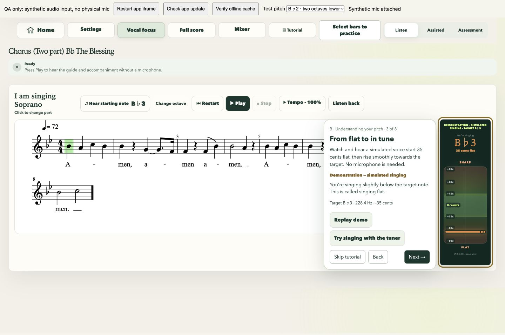
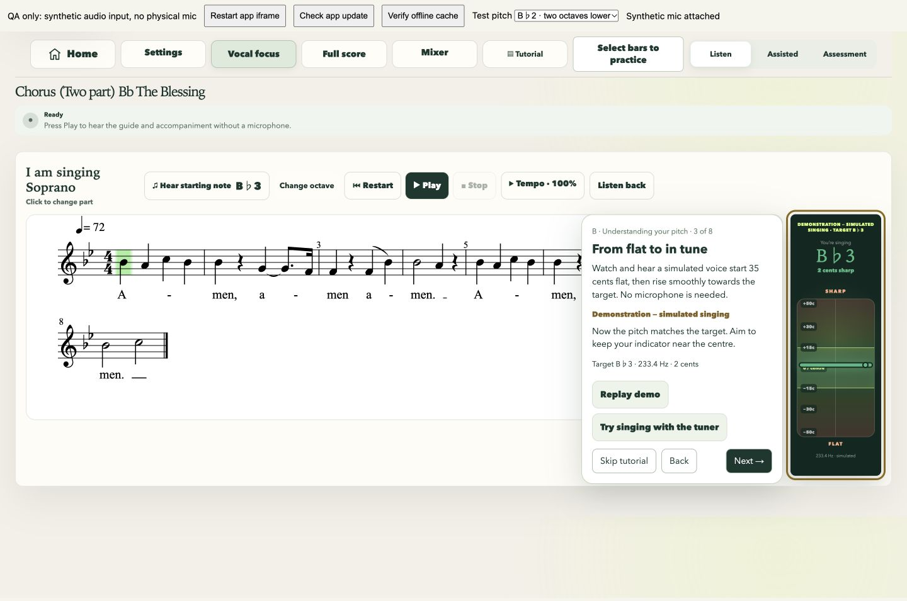
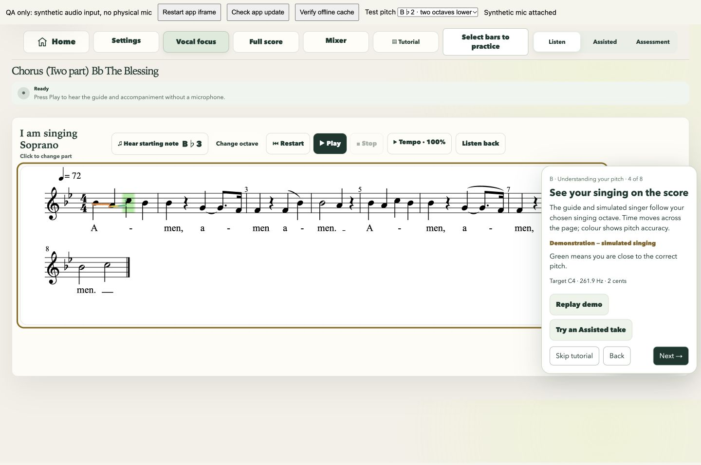
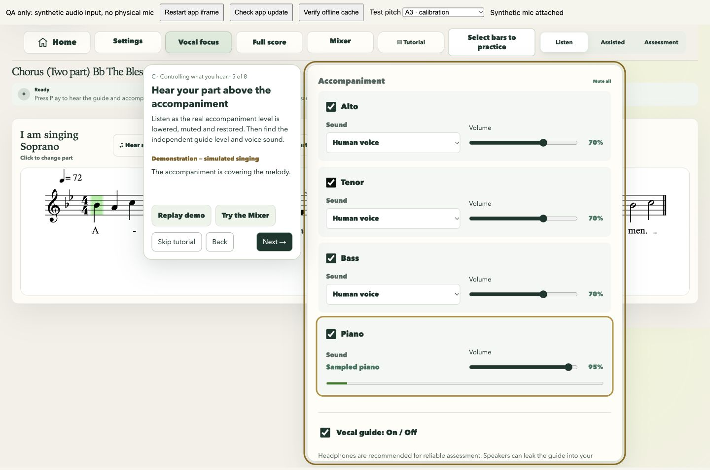
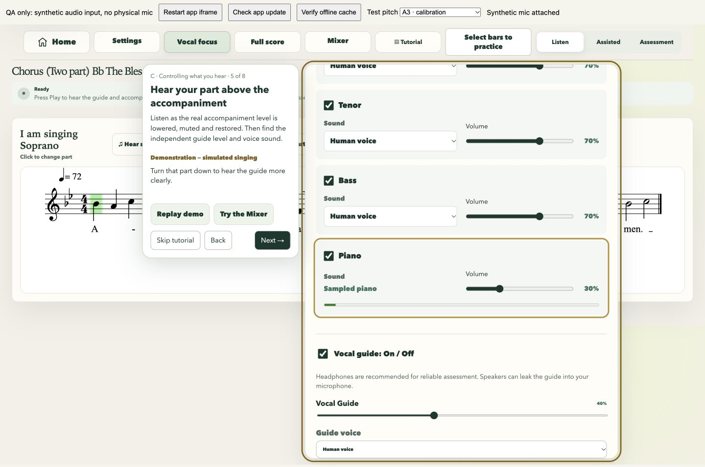
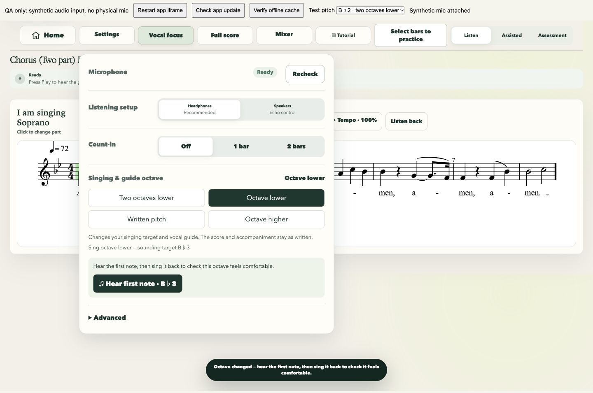
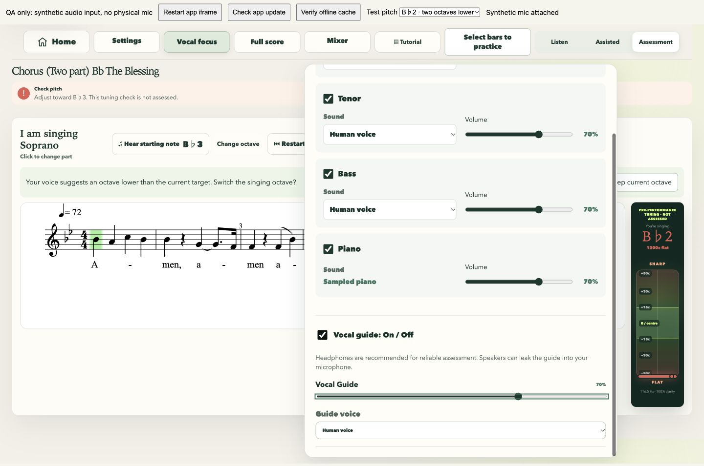
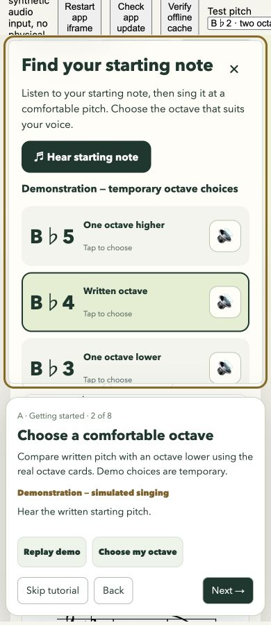
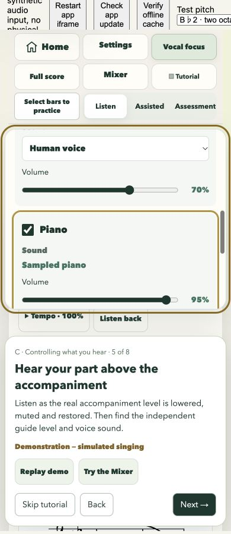
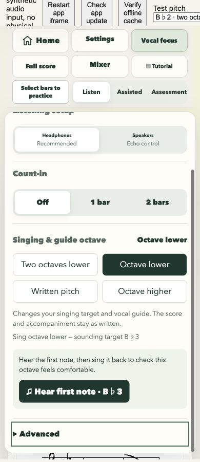
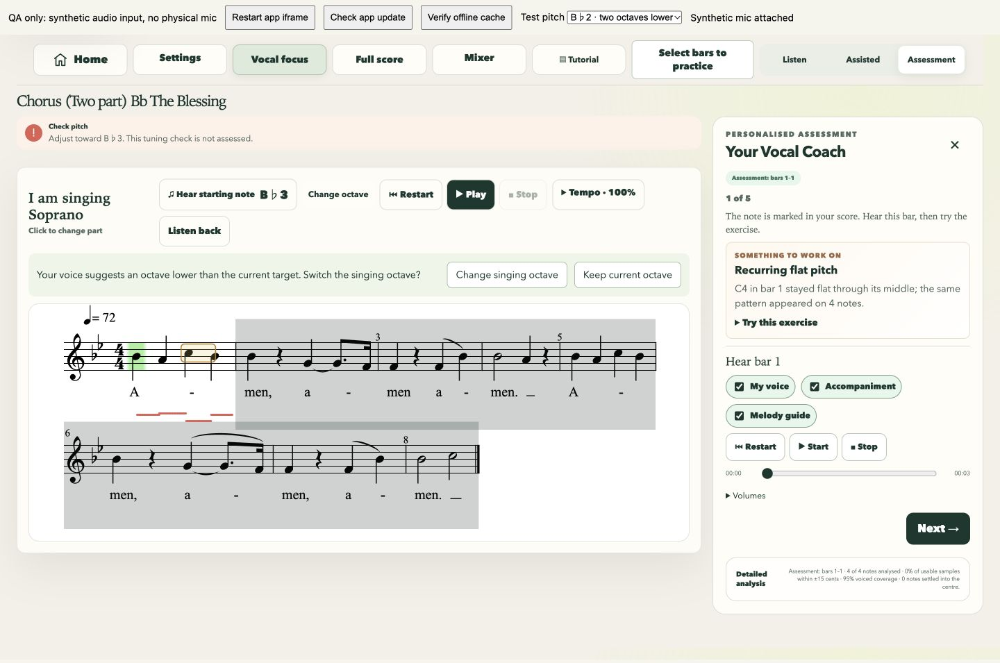

## Remaining device checks

Browser audio/output graphs and synthetic input were tested; no physical microphone, headphones, loudspeaker, iOS Safari or Android installed-PWA session was available. Verify real room leakage, device permissions, hardware latency and guide audibility on those devices. Transposed human samples can sound less natural at extreme octaves. Very dense individual measures retain OSMD's normal minimum-spacing limits. Scoring and generated feedback remain prototype practice aids.
