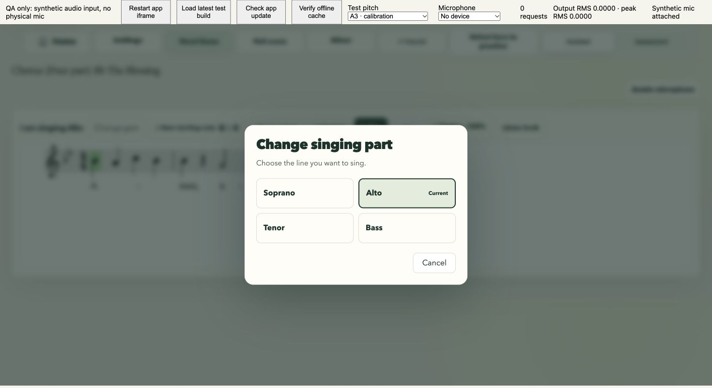
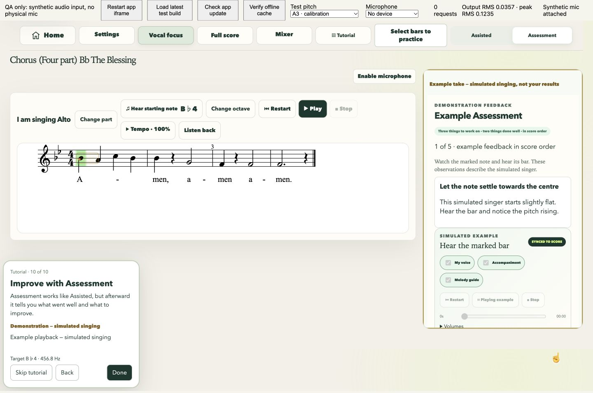
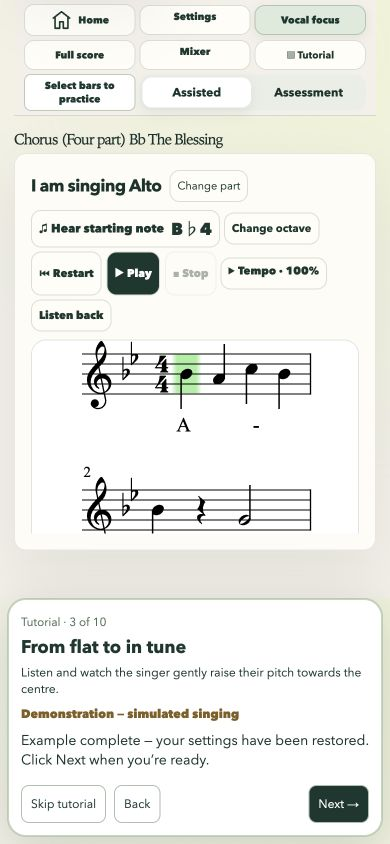

# Automatic Tutorial and studio preparation validation

## Changes

The navigation tour and separate Singing Lessons have been replaced by one ten-lesson Tutorial. Opening a score offers it once; completing or skipping stores `vocal-coach:tutorial:v5`. Earlier tour completions deliberately do not suppress this redesigned experience. There is no second welcome tutorial. Tutorial replays from lesson one while the studio is idle.

Every lesson starts its example automatically. Back restarts the previous example, Next advances, Done finishes the last lesson, and Skip/Escape stop the example. An autoplay-blocked first visit shows the visual explanation and uses Next to unlock and restart the audible example. Lessons never advance themselves.

The examples use the current score and real guide/accompaniment instruments. Mixer inputs change actual channel gains, tempo changes actual control values and musical scheduling, practice selection dims outside bars and plays two passes, and view selection re-renders OSMD. Assisted/Assessment use labelled simulated singing and isolated copies of the production review surfaces. Assessment demonstrates three improvements and two positives in score order, corresponding bar playback, then full-example playback and volume controls. Demo controls are illustrative; Tutorial navigation remains the only active navigation. No recording is created or saved.

Cancellation restores Mixer settings, octave choice, tempo, range/Repeat, view, mode, cursor, tuner text and any existing review. A paused real review is detached from temporary demo gain changes and restored afterward. Pending loads and score renders cannot restart a cancelled example. Stopping an inactive Tutorial does not touch a real take's count-in or review.

Hear starting note now plays the selected octave, highlights the tuner and invites “Now sing that note!” when an already-enabled microphone is available. Listening starts after a 1.25-second preview/decay interval. It does not request microphone permission or create assessment samples. It has no response deadline. Manual octave selection remains available without a microphone.

Preparation register recognition accepts candidates within three semitones, requiring at least eight reliable frames and 500 ms of consistent support with independent frequency corroboration. Noise, clipping, detector disagreement, harmonic corrections and wandering pitches are rejected. Performance matching remains at its original 60-cent octave-suggestion tolerance and multi-note evidence requirement; actual tuning/assessment accuracy thresholds are unchanged. Suggestions use a confirmation dialog, apply directly, support Keep/manual selection, and defer during a recorded take.

Change part now opens an in-place vocal-part picker, preserving each part's saved octave. Selecting another part confirms before abandoning a running take. Cancel does not switch parts. The existing score and microphone stream are reused. The picker has a smaller heading, even choices, a Current marker and a compact Cancel action. Change octave has a proper matching border. Normal pitch feedback stays in the tuner; operational failures retain compact accessible feedback and existing calibration/error dialogs.

## Automated validation

All requested commands passed, with `npm run check` run under Node 20:

- `npm run generate`
- `npm run check`: **257 tests passed**, no failures/skips
- `npm run build`
- `npm run offline:check`: **170 verified assets, 14.6 MB**
- `git diff --check`

New/updated checks cover one-time onboarding/migration, lesson ordering and auto-start wiring, rapid navigation and asynchronous cancellation/restoration, blocked audio, pitch/audio agreement, proportional tempo and Repeat timing, rests, shared guide settings, unchanged real recordings and paused review volumes, selected-octave preview, delayed preparation sampling/cancellation, microphone-free playback, fast octave evidence, clipping/noise/harmonic rejection, and deferred confirmation during recording.

The explicit written **D3 / sung C♯2** regression suggests **D2 after 500 ms** of stable input while retaining **−100 cents** of pitch error. The same one-semitone discrepancy does not pass the stricter recorded-performance octave detector.

## Browser checks

Chrome was checked at desktop (1440 × 900 app area), tablet (834 px wide), and phone (390 × 844), using the included four-part Chorus score. Checks included:

- First-use launch directly into lesson one; completion/Skip suppresses relaunch; Tutorial replays.
- Back/Next rapid transitions through every lesson, including cancellation during view rendering; no browser errors observed.
- Microphone-free examples: the QA getUserMedia counter remained **0 requests** across all ten lessons.
- Real Web Audio output measured above silence during examples (observed peak window RMS about **0.1235**). Mixer sliders brought parts up independently; tempo visibly reached **70%**; Repeat visibly reached **pass 2 of 2** with dimmed outside bars.
- Full Score rendered Soprano, Alto, Tenor, Bass and Piano, matching its selected button, before returning to Vocal Focus.
- Assisted example review and five Assessment observations, marked notes/bar playback, full-example playback controls, and cleanup on completion/Skip.
- Synthetic microphone calibration and preparation: C♯3 against written D4 produced a D3 suggestion; accepting updated the starting-note label to D3 and the live tuner still read about **−100 cents flat**.
- In-place part selection (Tenor → Alto → Tenor), Cancel, saved D3 octave restoration, and mobile text fitting. Returning to Tenor retained the existing microphone stream: the acquisition counter stayed at one.
- A normal Assisted count-in and short synthetic-input recording/review still worked. Replaying and skipping Tutorial preserved that captured audio URL, playback position and custom 67% review accompaniment level.
- The low C♯2 fundamental also suggested D2 from an already-selected D3 register; Keep and Choose another octave preserved the current setting or opened the stacked manual selector.

All microphone input in these checks was **synthetic Web Audio input**, including calibration. **No physical microphone was tested.** Responsive checks used Chrome viewport sizes, not native iOS/Android browsers. Safari/Firefox autoplay and real-device acoustic echo/reverberation remain hardware/browser validation items; no native-browser or real-room claim is made here.

## Screenshots

[Automatic Mixer demonstration](mixer.png) · [70% tempo](tempo.png) · [second Repeat pass](repeat.png) · [Assessment example](assessment-demo.png) · [full-example controls](full-example-review.png) · [octave confirmation](octave-confirmation.png) · [in-place part picker](change-part.png) · [mobile part picker](mobile-part-picker.png) · [mobile Tutorial](mobile-tutorial.png)

