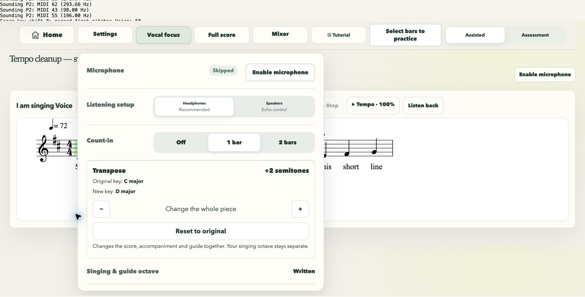
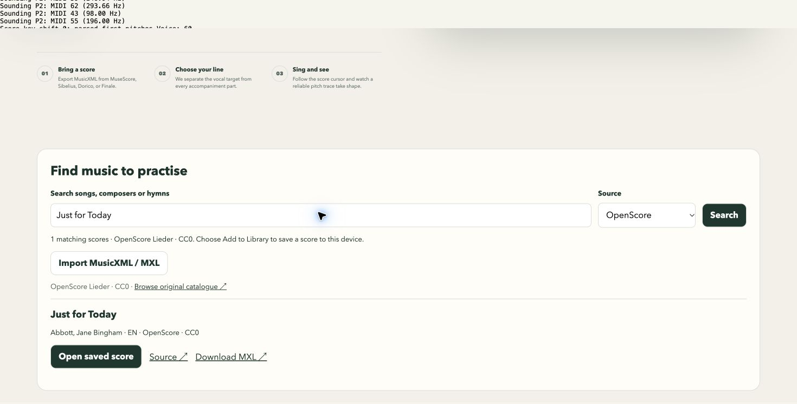
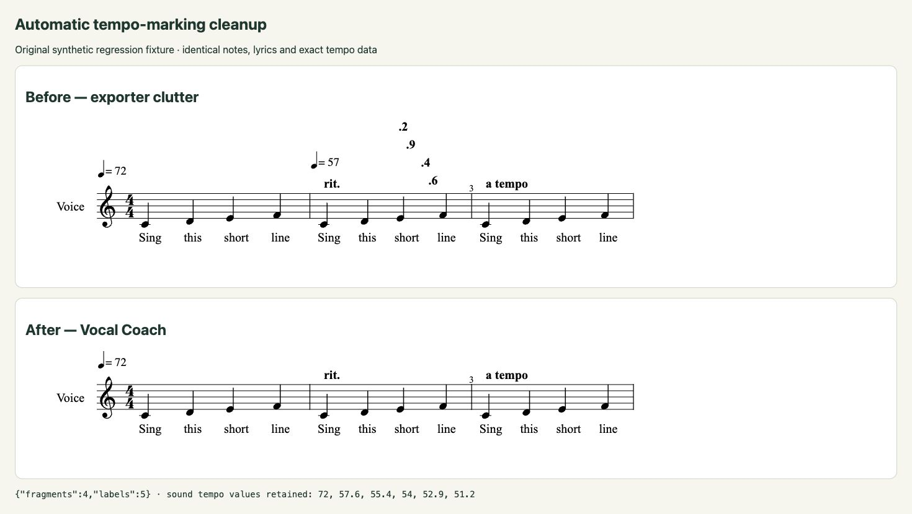

# Transpose, Find Music and notation cleanup

Validation on 22 October 2026. Feature branch starts at latest `main` (`1d5e63c`). No merge requested or performed.

## Implemented behaviour

- **Transpose** is immediately above Singing & guide octave in Settings, from −12 to +12 semitones with Reset. It prepares the score from original MusicXML every time, changes notes, conventional key signatures, chord roots and slash basses, then reparses playback targets and replaces OSMD notation and geometry. Written pitches and sounding pitches remain separate for transposing instruments. Ties retain spelling through key changes. Rests, lyrics, durations and other directions remain unchanged. Unpitched notes are untouched.
- **Independent singing octave** remains a separate shift for the guide and assessment. Transpose affects all pitched parts; the singing octave never affects accompaniment.
- Changing key is blocked during a recorded take. Music-only transport stops cleanly first. Selected part, singing octave, Mixer settings, tempo, practice bars, Repeat, score view and position survive the change. Transpose is stored per library item; saved tempo, practice range, Repeat and view also restore on reopen. A completed recording retains its original transposition. Its player is disabled with an explanation in other keys, and re-enabled when the recording's key is restored; old traces are cleared on changing key.
- **Find Music** searches a local, lazily loaded catalogue by title, composer, collection and available language metadata. OpenScore downloads go through the ordinary file/ZIP/XML safeguards and IndexedDB repertoire system, preserving original filename, MIME and file bytes. Source identity and hash prevent duplicate entries. Existing saved results open without a download. All result text is inserted as text, and downloads use a bounded stream and an allowlisted, commit-pinned URL. Providers are separate adapters; no unverified hymn collection is enabled.
- **MuseScore** is an external search link with `target="_blank"` and `rel="noopener noreferrer"`. There is no MuseScore scraper, download API or redistribution. MusicXML/MXL import remains alongside it; MSCZ export and PDF limitations are explained.
- **Automatic cleanup** runs on every import/open, including saved files and transposed scores. A decimal fragment is removed only when its metronome integer plus fraction agrees with encoded sound tempo. Dense monotonic fractional/offset ramps have redundant printed metronomes suppressed. The source file and all `sound tempo` events survive.

## Verified source and catalogue refresh

Source: [OpenScore Lieder catalogue](https://fourscoreandmore.org/openscore/lieder/) and [OpenScore/Lieder](https://github.com/OpenScore/Lieder), [CC0 licence](https://github.com/OpenScore/Lieder/blob/38c5db510224d9facdc4b08d741fc788cfb58ea8/LICENSE.txt).

The committed metadata manifest is **313,121 bytes**, covering **1,414 MXL paths** verified against the repository tree at `38c5db510224d9facdc4b08d741fc788cfb58ea8`. **48 stale links** from the published catalogue were excluded. Only metadata ships, not the score collection. The score is fetched on selection, from `raw.githubusercontent.com` at the pinned commit. A genuine download returned HTTP 200, `application/octet-stream` and `Access-Control-Allow-Origin: *`; the browser import from localhost also succeeded across origins.

Run `npm run catalogue:refresh` to regenerate from the repository's generated catalogue and validate all referenced paths against its Git tree. Normal generate/build/check commands use the committed manifest and make no catalogue network request. Future providers must supply a local manifest, source attribution and a bounded, allowlisted downloader.

## Browser evidence

Chrome desktop and a **390 × 844 responsive viewport** were checked. This was not a physical Android or iOS device, and not an installed-PWA/device test. The local QA page supplied synthetic microphone input; **no physical microphone** was used.

1. Searched **Just for Today** by Jane Bingham Abbott, clicked Add to Library, downloaded the genuine `lc6583477.mxl`, saved it and opened Voice/Piano part selection. Voice contained 96 pitched events. A later search showed **Open saved score**; the library contained one imported copy of this source.
2. Original first Voice note: **C4 / MIDI 60**. Original first Piano note: **F4 / MIDI 65**. At **+2**, parsed notes were **D4 / MIDI 62** and **G4 / MIDI 67**. The displayed key signature changed with the notation. With the independent singing octave at −12, Hear starting note scheduled **MIDI 50 / 146.83 Hz (D3)** through the actual playback instrument. The accompaniment retained the whole-score shift only. The QA audit wrapped instrument scheduling to display actual note MIDI/frequency, rather than changing application state.
3. Transposed again with Piano at **37%**, tempo **85%**, bars **6–9**, Repeat checked and Full Score selected. All remained unchanged. The notation container retained **one** current OSMD SVG page, with no stale appended copy.
4. Recorded a synthetic Assisted phrase at +2 / octave −12, with **223 trace points and 212 connecting segments** on the rendered transposed score. Recorded audio played. Changing to +3 disabled Listen back and showed “Your recording uses 2 semitones. Restore that transposition to listen back.” Restoring +2 re-enabled the same recording and it played again.
5. Reopened the saved item: +2, octave lower and the selected working preferences restored. With the **local server stopped**, recreated the app iframe; cached assets loaded, the local catalogue was searchable, and the saved MXL opened at +2, octave lower and 85%. This demonstrates cached app/score operation with the origin unavailable, not a claim that the computer's entire network was disabled.
6. MuseScore opened a separate tab at `https://musescore.com/sheetmusic?text=People%20Need%20the%20Lord`, with the matching search-page title. The Vocal Coach tab and saved library remained available. No score was downloaded from MuseScore.
7. Returned and imported the original, synthetic cleanup `.musicxml` fixture through the ordinary native Chrome file picker. The extension's automated chooser API lacked file-URL permission, so the native picker was used successfully without changing browser permissions. In the studio its Settings showed **C major → D major** at +2.
8. The synthetic before/after renderer showed `.6`, `.4`, `.9`, `.2` before cleanup; afterward those four fragments and five ramp labels were gone, while **rit.**, **a tempo**, lyrics and the starting **72 BPM** mark remained. Encoded tempos remained **72, 57.6, 55.4, 54, 52.9, 51.2**.
9. Phone-width checks kept Transpose within the Settings panel and Find Music within the viewport. These screenshots show responsive emulation only.

## Automated validation

All required commands passed; `npm run check` was run under **Node 20**:

- `npm run generate`
- `npm run check`: **284 tests passed**, no failures/skips
- `npm run build`
- `npm run offline:check`: **173 verified files, 14.9 MB** (previous build 14.6 MB)
- `git diff --check`

New tests include standard major/minor signatures across all 25 shifts from −12 to +12; chromatic notes, accidentals, chords, slash harmony, tied-note spelling, key changes, multiple parts, transposing-instrument chromatic and octave declarations, written-note geometry, timing preservation, original-source reset/non-additivity, recording locks/key context, separate saved octave/transpose, preserved engine settings, restored working preferences, catalogue matching and attribution, encoded external searches, bounded failed downloads, preserved bytes/filename/MIME, IndexedDB reopening and XML/file-safety rejection. Cleanup tests distinguish matching tempo fractions from unrelated decimals and preserve exact tempo values and musical text. Only a short synthetic score is committed as a regression fixture.

## Genuine limitations

- The existing playback engine uses **one initial tempo**, scaled by the Tempo control. Preserving encoded XML ramp events does **not** mean ritardando/accelerando curves are performed. This change deliberately does not introduce an untested tempo-map playback system.
- Standard partwise, integer-semitone notation is supported. A requested nonzero transpose rejects nontraditional key signatures, microtonal pitches, tablature/scordatura, doubled transpose declarations, required accidentals beyond double sharps/flats, or pitches outside MIDI range, with a clear error. Timewise MusicXML remains unsupported. The original score remains available at zero transpose.
- A key is only named major/minor when explicit, consistent key metadata supports it. Missing/ambiguous mode or changing keys are labelled accordingly. The genuine OpenScore test song does not explicitly specify a reliable single mode, so the app does not invent one.
- Old recorded audio is not pitch-shifted. Restore the recording's transposition before reviewing it. Changing key clears existing visual traces so they cannot be mistaken for new-key results.
- A first external download requires a connection; saved imports and a previously cached catalogue work locally. Unsupported or unavailable external scores give an error plus source/download/import fallback.

## Screenshots

[Transpose C → D](transpose-c-major-to-d.png) · [OpenScore settings](transpose-settings.png) · [original notation](original-score.png) · [transposed notation](transposed-score.png) · [sounding pitches](playback-pitches.png) · [recorded review](transposed-review.png) · [Find Music](find-music.png) · [genuine import](openscore-import.png) · [MuseScore link](musescore-external.png) · [external results loaded](musescore-search-loaded.png) · [cleanup before/after](tempo-cleanup-comparison.png) · [cached score](offline-saved-score.png) · [mobile Transpose](mobile-transpose.png) · [mobile Find Music](mobile-find-music.png)

