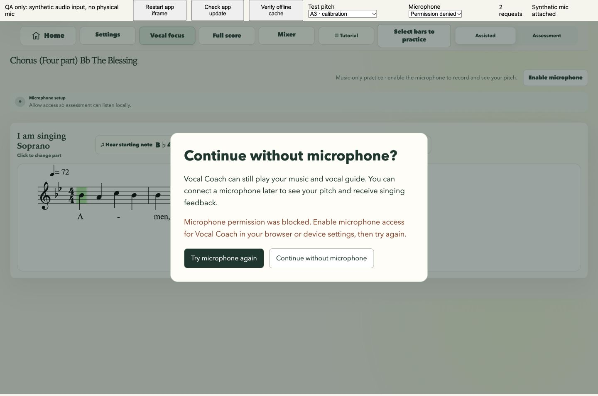
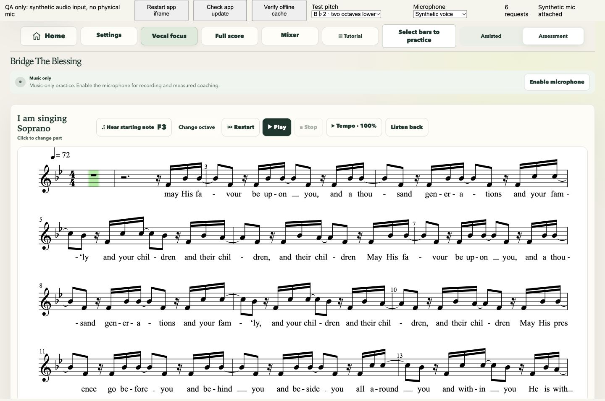
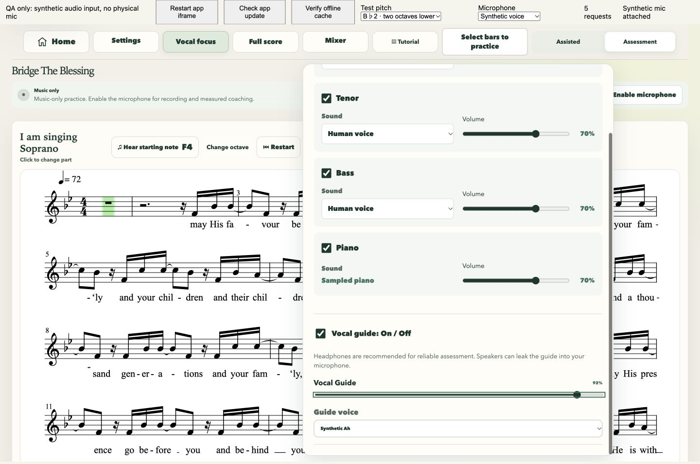
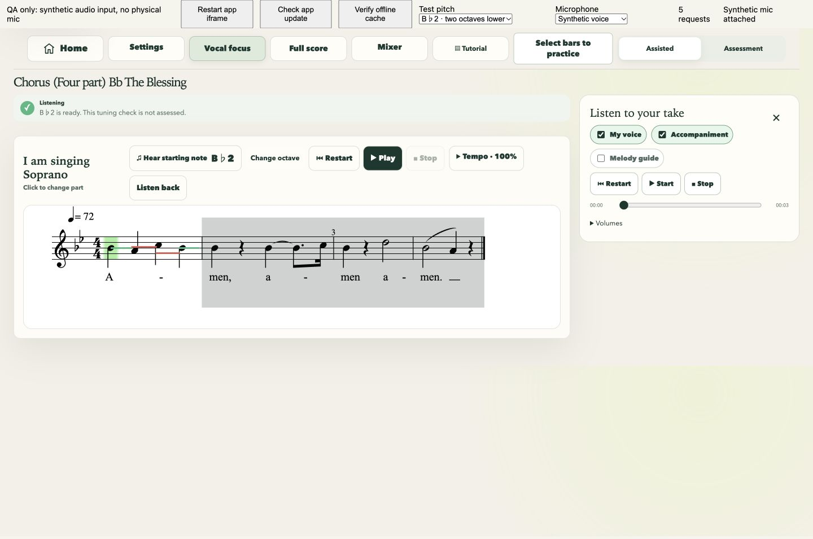
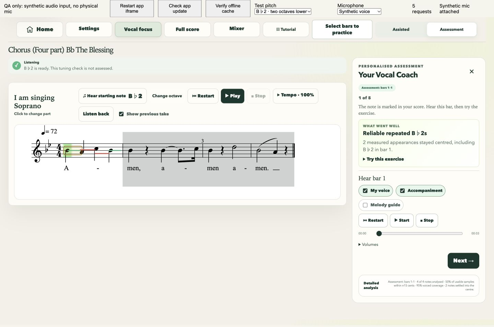
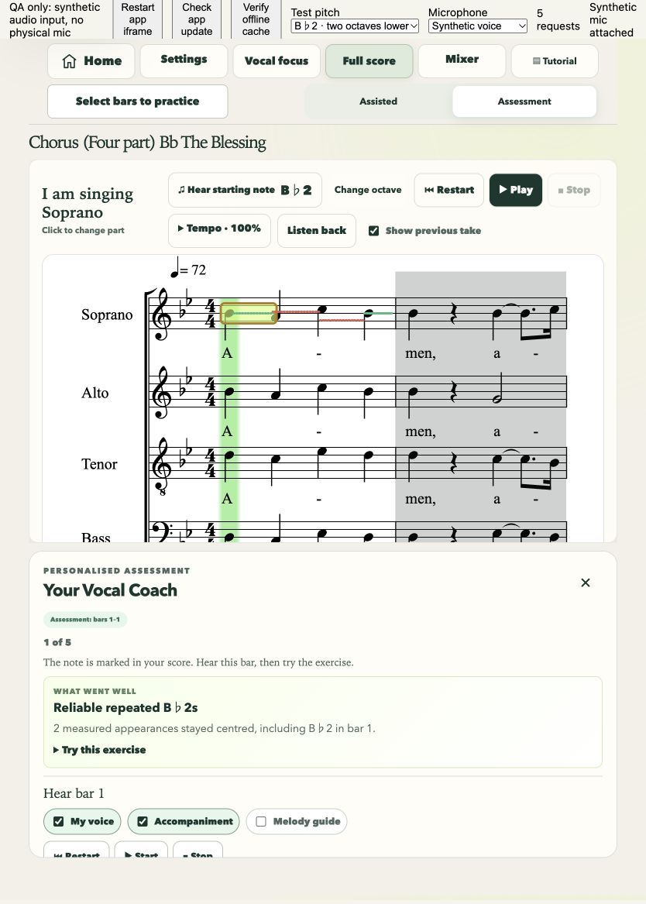
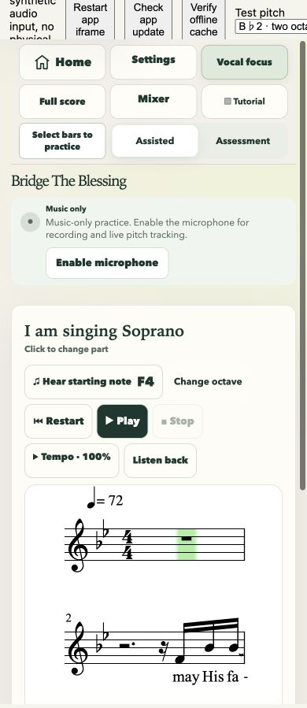
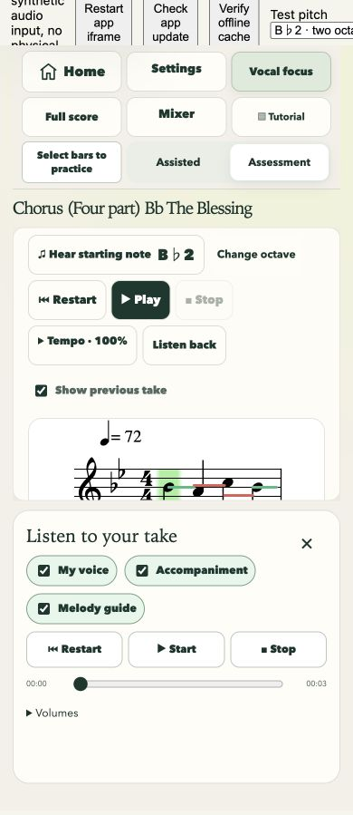
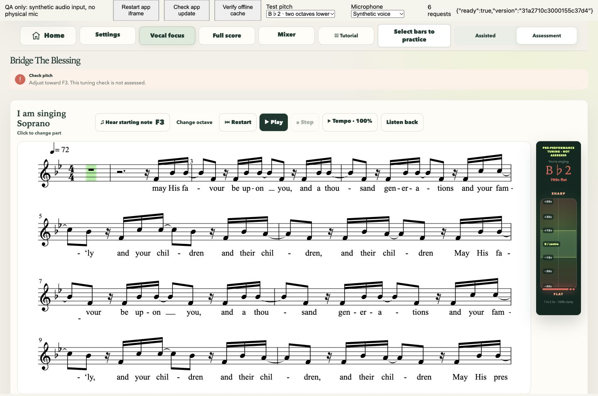
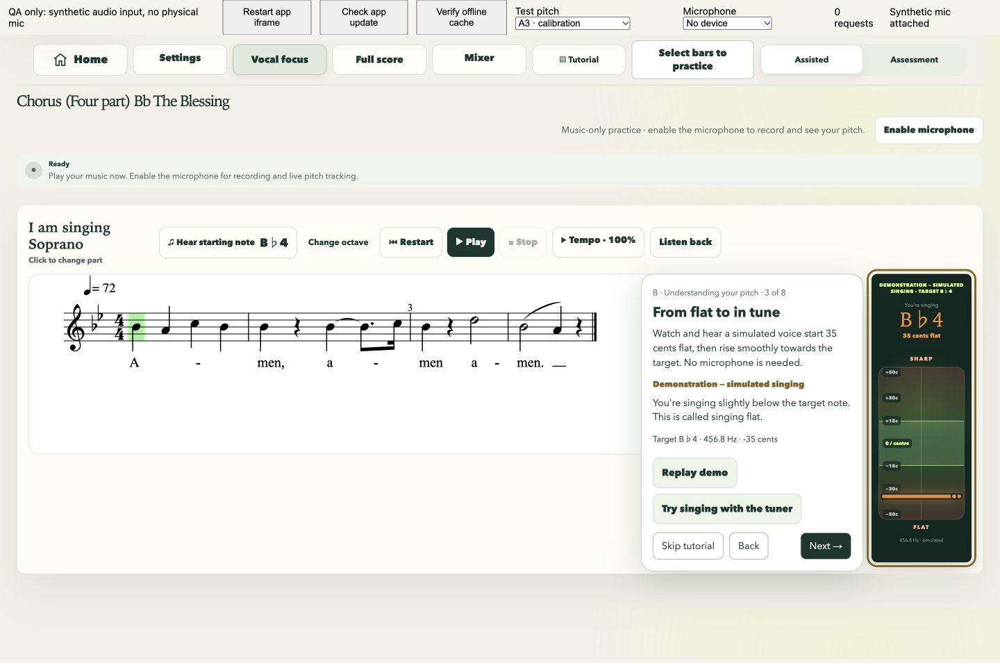

# Unified Assisted and Assessment practice

Prepared from the latest main after PR #14 and the subsequent repertoire uploads. This change removes the Listen mode while preserving music-only playback.

## Two modes, one singing experience

Assisted is the default for a new score. Both modes use the same playback engine, default enabled vocal guide at 92%, chosen guide sound, accompaniment mix, singing/guide octave, count-in, tempo, practice range and repeat. With an active microphone, both show the same tuner/trace and record the same local input.

Only completion differs: Assisted opens the compact recording player. Assessment computes measured coaching and presents the existing five observations in score order, with note highlighting, bar playback, Back/Next and full-take review. Both review layers still offer voice, accompaniment and melody guide. Settings and octave/mix controls remain locked during takes.

`SESSION_MODES` contains exactly `assisted` and `assessment`. Old `listen` and invalid saved modes migrate to Assisted. A saved valid Assessment choice remains available when reopening that score.

## Microphone availability is independent of mode

A session decision (`unchecked`, `ready`, or `skipped`) and the engine's actual live audio track determine whether microphone features are available. A calibration saved on the device alone is not proof of an active microphone.

- The normal guided room-and-voice calibration remains. Initial setup can be skipped directly.
- Missing devices, denied permissions and unsuccessful calibration offer **Continue without microphone?**, the requested explanation, and **Try microphone again / Continue without microphone**. The measured or permission-related failure reason is shown separately.
- Choosing Continue or dismissing setup skips microphone activation for this app session, across both modes and score changes. Mode changes never reacquire the microphone.
- **Enable microphone**, beside the score's status and in Settings, retries later while retaining the current score, guide mix, part and octave. A successful check turns monitoring on only after Continue.
- Music-only playback, starting-note previews, manual octave cards, Mixer, tempo, practice bars/repeat, score views and interactive demonstrations remain available. Starting-note preview no longer requires calibration or opens an octave selector automatically.
- Recording setup uses actual microphone availability. Music-only playback cannot create take metadata, start microphone recording, or finish a fabricated assessment. Previous genuine recordings remain separate and accessible.
- The score gets its full width when monitoring is unavailable; when enabled, the existing ResizeObserver/OSMD reflow places the tuner beside it on desktop and above it on phones. Layout changes rebuild traces and cursor geometry.

The engine now checks live audio-track state, rather than treating a stale stream reference as active. A disconnected stream stops pitch sampling and updates the UI; another activation can acquire a replacement. Real-device unplug/reconnect behaviour still needs hardware testing.

## Shared guide preferences and migration

A score now saves one `guideSettings` object containing enabled state and volume. Guide voice remains the existing independent Human/Synthetic Ah preference. Mode switching does not replace any of these values.

Migration precedence:

1. Use the new shared object when present.
2. Prefer a deliberate legacy choice in the saved mode: guide off, zero volume, or a level different from that mode's former default.
3. Otherwise preserve a deliberate choice from another legacy mode, then a custom old global volume.
4. Untouched former defaults become the normal shared enabled 92% guide. The old Assessment 70% default does not become a new mode distinction.

The old schema did not distinguish explicitly choosing 70% from leaving Assessment at its automatic 70% default. That indistinguishable default migrates to 92%; other custom levels and disabled settings are retained. New writes use the shared schema, so future mode switches have no ambiguity.

The existing `guideOctaveShift` path is preserved. −24, −12, 0 and +12 change only the selected guide and microphone target; notation, MusicXML and all other vocal/piano parts stay unchanged. The immutable recording metadata preserves enabled state, guide level/sound and guide octave for review. The first-note encouragement and direct preview remain beside octave choices.

## Verification

**238 automated tests pass**, including new production-path tests for mode changes, shared-setting migration, music-only versus recorded playback, skip and later activation, calibration failure/retry, real recording completion versus fabricated results, live-track availability, and Assisted versus Assessment review. Existing octave routing tests still cover all four shifts and unchanged accompaniment. Tutorial isolation, score reflow, recording synchronization, scoring and file preservation tests remain passing.

Commands: `npm run generate`, `npm run check` with Node 20, `npm run build`, `npm run offline:check`, and `git diff --check`.

Browser checks used Chrome and a clearly labelled external QA harness supplying synthetic `getUserMedia` input; no physical microphone permission was requested:

- A fresh score selected Assisted with its guide on at 92%. Assessment retained the same 92% level and Synthetic Ah choice.
- Missing-device and denied-permission requests displayed the requested fallback. After skipping, previews, octave changes, mode changes and a one-bar playback made no additional microphone requests and produced no recording/coaching panel.
- Silent input failed calibration and offered retry/continue. Retrying with synthetic voice completed calibration. Activation retained B♭2, the selected score and the 50% guide mix.
- A synthetic Assisted take opened recording playback automatically. Assessment with the same setup produced five score-ordered observations, bar playback and full review. The test take analysed four notes with 95% voiced coverage; two centred notes were measured from the input.
- All five coaching pages were traversed in order. Melody guide review playback worked with the take's captured octave.
- On the longer Bridge score, enabling monitoring changed the actual notation from six systems at 1356 px to seven systems at 1236 px; the chosen F3 target stayed unchanged.
- Tablet resizing/Full score preserved all 250 current/previous trace sample elements. Tablet notation measured 724 px and wrapped onto multiple systems. Phone portrait retained readable notation and accessible compact review.
- Interactive flat/in-tune demonstration ran before setup with **zero** microphone requests. Manual octave cards worked after skipping. Tutorial samples remained temporary.
- Viewports: app 1440×900, 834×1112 and 390×844, with a separate 55 px external QA toolbar. With the local server stopped, the cached app reopened Bridge in music-only Assessment, previewed F3 and ran the first-note tutorial. Cache verification reported ready. The offline validator verifies 169 project-path assets, including all tutorial/audio modules.

The generated repertoire index is refreshed to match the four source score files already present on the starting main branch. No score source file is changed by this feature.

## Screenshots

## Remaining device checks

Real microphones, physical speaker leakage, hardware unplug/reconnect, mobile browser permission UI, iOS Safari and installed Android/iOS PWA recording need device verification. Headphone advice and the existing calibration/echo-control safeguards remain. MediaRecorder availability still depends on the browser; reliable microphone pitch can still produce measured feedback when audio recording is unsupported.
